<p align="center">
  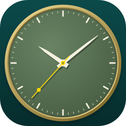
</p>

<h1 align="center">Qt Clock</h1>

<p align="center">
  A beautiful, themeable analog + digital clock for your desktop.<br>
  Pure Qt Widgets · resolution-independent · no dependencies beyond Qt.
</p>

<p align="center">
  <a href="https://github.com/YusufUSLC/qt-clock/actions/workflows/ci.yml"></a>
  <a href="LICENSE"></a>
  
  
  
  
</p>

<p align="center">
  <a href="README.tr.md">Türkçe</a>
</p>

<p align="center">
  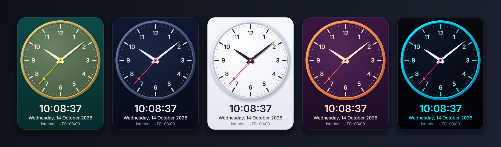
</p>

## Why Qt Clock?

Most Qt clock examples are a handful of lines drawing three lines. Qt Clock is a small but complete
desktop application that shows how far plain **Qt Widgets** and `QPainter` can go: a vector-drawn
dial that stays razor-sharp at any size, five hand-tuned themes, time zones, a frameless
"desktop widget" mode, and a rendering pipeline that sleeps when nobody is looking.

<p align="center">
  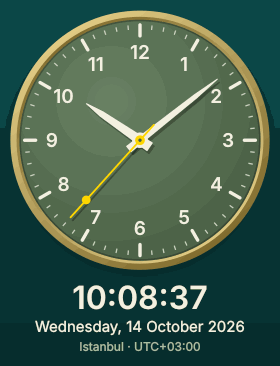
  &nbsp;&nbsp;&nbsp;
  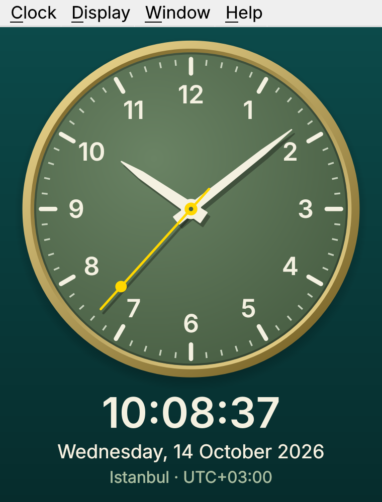
</p>
<p align="center"><sub>Left: the five themes (time-lapse, 5× speed). Right: the real application window.</sub></p>

## Features

- **Crisp at any size.** Everything is drawn in a logical coordinate system and scaled to fit, so the
  clock looks identical from 160&nbsp;px to full screen and on HiDPI displays.
- **Five themes** — Forest, Midnight, Daylight, Sunset and Neon. <kbd>Ctrl</kbd>+<kbd>T</kbd> cycles
  through them. Adding your own takes one table entry.
- **Smooth sweeping second hand** (30&nbsp;fps) or the classic tick. Hands behave like a real watch:
  the hour hand creeps with the minutes, the minute hand with the seconds.
- **Time zones.** Local time, a shortlist of popular cities, or any IANA zone. Shows the city and the
  live UTC offset, and handles daylight saving time.
- **12 / 24-hour display** — defaults to what your locale uses — and a localised date line.
- **Desktop-widget mode.** Frameless, rounded, translucent, draggable and optionally always on top.
  <kbd>Esc</kbd> brings the window frame back.
- **Full-screen desk clock** with <kbd>F11</kbd>.
- **Zoom** with <kbd>Ctrl</kbd>+<kbd>+</kbd> / <kbd>Ctrl</kbd>+<kbd>−</kbd> or <kbd>Ctrl</kbd>+mouse wheel.
  The window keeps the clock's aspect ratio.
- **Your own logo** on the dial (see [Custom logo](#custom-logo)).
- **Remembers everything** — theme, time zone, options, window size and position.
- **Easy on the CPU.** The static dial is cached, repaints are aligned to the second boundary, the sweeping
  second hand repaints only the small area it moves through, and the timer stops completely while the
  window is hidden or minimised.
- **Qt 5.15 and Qt 6**, builds with **CMake** or **qmake**, covered by a unit-test suite.

## Themes

<table>
  <tr>
    <td align="center">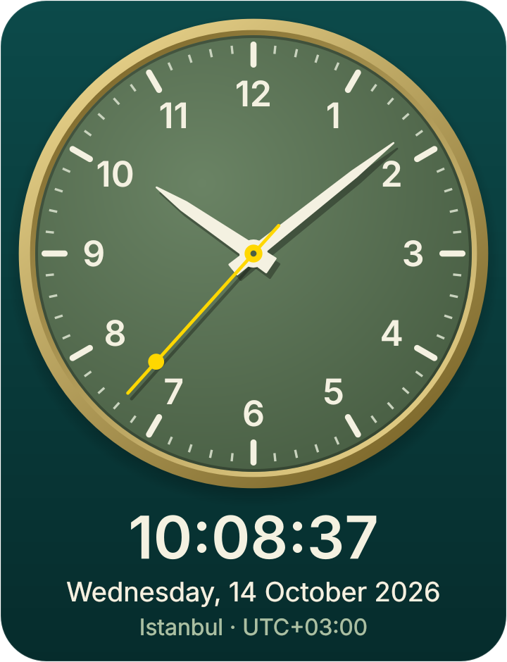<br><b>Forest</b></td>
    <td align="center">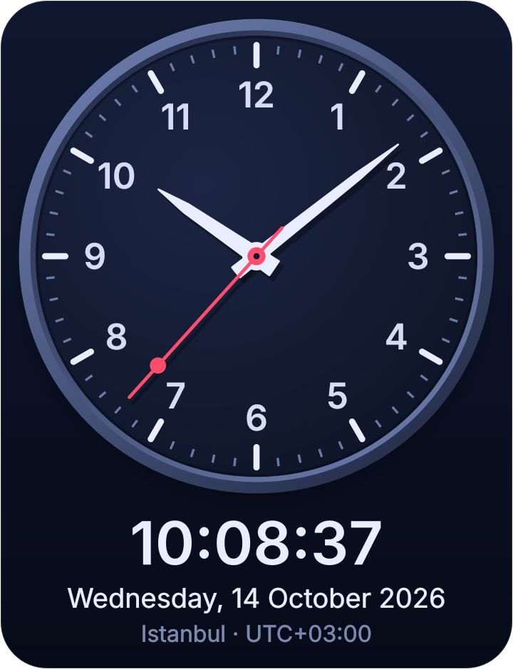<br><b>Midnight</b></td>
    <td align="center">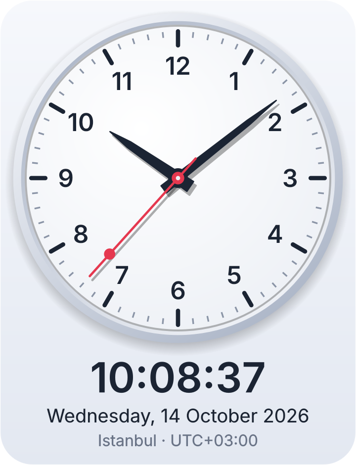<br><b>Daylight</b></td>
    <td align="center">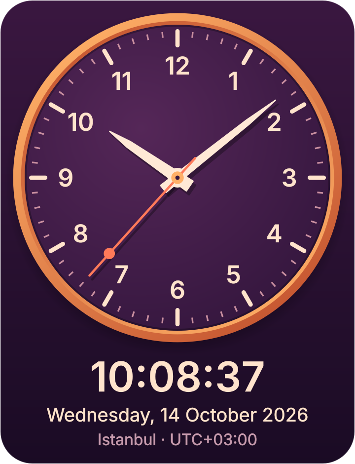<br><b>Sunset</b></td>
    <td align="center">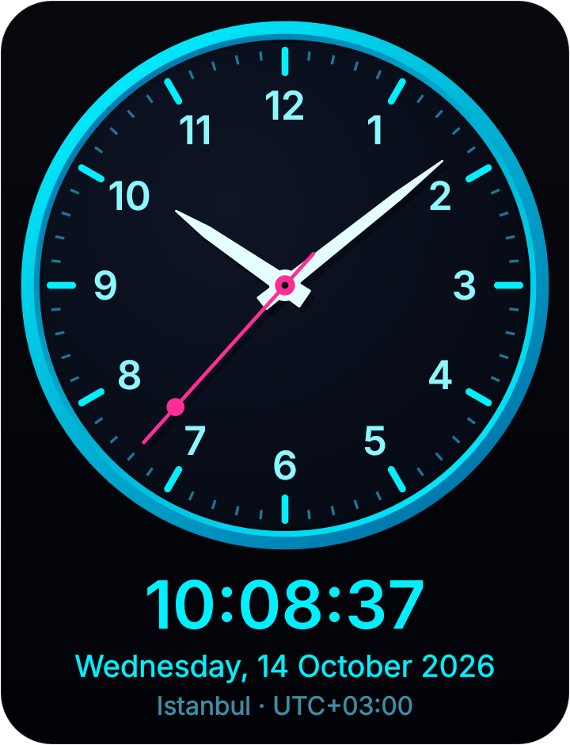<br><b>Neon</b></td>
  </tr>
</table>

## Getting started

### Requirements

- A C++17 compiler
- Qt **5.15** or **Qt 6** (only the *Widgets* module is needed)
- CMake 3.16+ (or qmake)

<details>
<summary><b>Installing the requirements</b></summary>

| Platform | Command |
| --- | --- |
| Ubuntu / Debian (Qt 6) | `sudo apt install build-essential cmake ninja-build qt6-base-dev libgl1-mesa-dev` |
| Ubuntu / Debian (Qt 5) | `sudo apt install build-essential cmake ninja-build qtbase5-dev` |
| Fedora | `sudo dnf install gcc-c++ cmake ninja-build qt6-qtbase-devel` |
| macOS (Homebrew) | `brew install cmake qt` |
| Windows | Install Qt with the [Qt Online Installer](https://www.qt.io/download-qt-installer) and CMake from [cmake.org](https://cmake.org/download/) |

</details>

### Build and run

```bash
git clone https://github.com/YusufUSLC/qt-clock.git
cd qt-clock

cmake -S . -B build -DCMAKE_BUILD_TYPE=Release
cmake --build build
./build/QtClock
```

The executable is `build\Release\QtClock.exe` with Visual Studio on Windows, and the app bundle
`build/QtClock.app` on macOS (`open build/QtClock.app`).

On Windows or macOS with Qt installed outside the default locations, point CMake at it with
`-DCMAKE_PREFIX_PATH=/path/to/Qt/6.x.x/<kit>`.

**Qt Creator:** open `CMakeLists.txt` (or `Clock.pro` if you prefer qmake) and press *Run*.

**Install** (Linux also gets a desktop entry and icon):

```bash
cmake --install build --prefix ~/.local
```

**Choose the Qt major version** when both are installed: `-DQT_VERSION_MAJOR_OVERRIDE=5` or `=6`.

### Run the tests

```bash
cmake --build build
(cd build && ctest --output-on-failure)
```

The tests run headless (`QT_QPA_PLATFORM=offscreen`), so no display is required.

## Using it

Right-click anywhere on the clock — or use the menu bar — to change the theme, time zone and display
options.

<p align="center">
  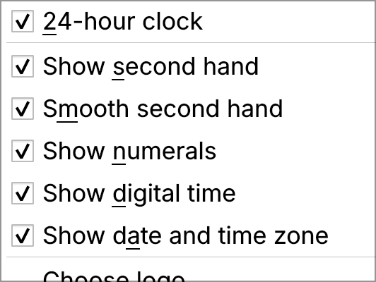
</p>

| Shortcut | Action |
| --- | --- |
| <kbd>Ctrl</kbd>+<kbd>T</kbd> | Next theme |
| <kbd>Ctrl</kbd>+<kbd>Shift</kbd>+<kbd>F</kbd> | Frameless desktop-widget mode (drag the clock to move it) |
| <kbd>Ctrl</kbd>+<kbd>Shift</kbd>+<kbd>T</kbd> | Always on top |
| <kbd>F11</kbd> | Full screen |
| <kbd>Ctrl</kbd>+<kbd>+</kbd> / <kbd>Ctrl</kbd>+<kbd>−</kbd> / <kbd>Ctrl</kbd>+<kbd>0</kbd> | Zoom in / zoom out / actual size |
| <kbd>Ctrl</kbd>+mouse wheel | Zoom |
| <kbd>Esc</kbd> | Leave full screen or frameless mode |
| <kbd>Ctrl</kbd>+<kbd>Q</kbd> | Quit |

On macOS, <kbd>Ctrl</kbd> is <kbd>⌘</kbd>.

> **Notes**
> - The translucent rounded corners of the frameless mode need a compositing window manager.
> - "Always on top" is a hint. Some Wayland compositors do not let applications set it.

Settings are stored with `QSettings` in the platform's usual place (the registry on Windows,
`~/Library/Preferences` on macOS, `~/.config/QtClock` on Linux).

### Custom logo

Qt Clock ships without any brand artwork. To put your own logo (a company, a club, your own mark)
below the 12, choose **Display → Choose logo…** and pick a PNG, JPEG, BMP, GIF or WebP file. A
transparent PNG that is wide rather than tall looks best. **Display → Remove logo** takes it off again.

<p align="center">
  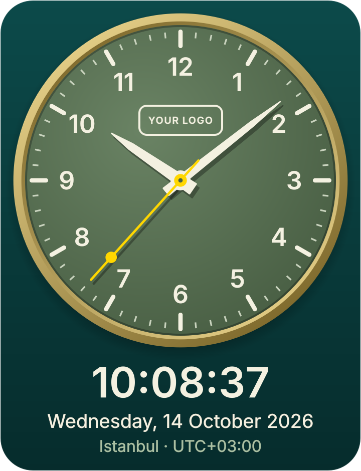
</p>

> Only use logos you have the right to use. The logo is loaded from your disk at runtime and is never
> copied into the application.

## How it works

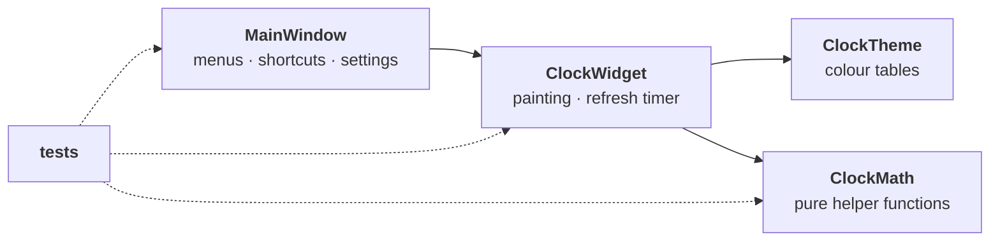

- **One coordinate system.** The dial is a circle of radius 100 *logical units*. `paintEvent` computes a
  single scale factor and translation, so no drawing code ever mentions a pixel size. Text is the one
  exception: fonts are sized in real device pixels to stay sharp instead of being scaled by the painter.
- **Static layer cache.** Bezel, face, ticks, numerals and logo only change when the theme, size or
  options change, so they are rendered once into a `QPixmap` (at the screen's device pixel ratio).
  Every frame only blits that pixmap and draws the hands and text on top.
- **No busy loop.** Instead of a fixed 1&nbsp;s timer that drifts against the system clock, a single-shot
  timer is scheduled for the next second (or minute, without a second hand) boundary. While the
  widget is hidden or the time is frozen there is no timer at all.
- **Partial repaints.** Within a second only the second hand moves, so between two full repaints the
  widget invalidates just the rectangle the hand has swept (`secondHandBounds()`). The test suite
  proves this is pixel-equivalent to repainting everything.
- **Testable core.** Hand angles, number formatting and offset formatting are pure functions in
  [`clockmath.h`](src/clockmath.h). Themes are plain data in [`clocktheme.cpp`](src/clocktheme.cpp).

### Project layout

```
src/
  main.cpp          entry point
  mainwindow.*      menus, shortcuts, settings, frameless / full-screen handling
  clockwidget.*     the clock itself: layout, painting, timer
  clocktheme.*      the built-in colour themes
  clockmath.h       pure helpers (hand angles, time formatting)
tests/              QtTest suite (runs headless)
tools/              screenshot / icon / demo generator for this README
resources/          application icon and author logo
packaging/linux/    .desktop entry
docs/               images used by this README
```

### Learning Qt from this code

New to Qt or C++? Every source file has short explanatory comments between the lines, written twice:
`// TR:` in Turkish and `// EN:` in plain (B1-level) English. They explain what each part does and
why: signals and slots, `QPainter`, `QSettings`, timers and the clock maths. The comments do not
change the program in any way. A good reading order is
[`clockmath.h`](src/clockmath.h) → [`clocktheme.cpp`](src/clocktheme.cpp) →
[`clockwidget.cpp`](src/clockwidget.cpp) → [`mainwindow.cpp`](src/mainwindow.cpp).

## Roadmap

Ideas that would make good first contributions — see [CONTRIBUTING.md](CONTRIBUTING.md):

- [ ] Alarms and a countdown timer
- [ ] World-clock view showing several time zones at once
- [ ] Roman-numeral and minimal (no-numeral) dial styles
- [ ] Translations (all UI strings already go through `tr()`)
- [ ] User-defined themes loaded from a JSON file
- [ ] Prebuilt binaries for Windows, macOS and Linux

## Contributing

Bug reports, new themes and pull requests are very welcome. Please read
[CONTRIBUTING.md](CONTRIBUTING.md) first; it explains how to build, test and add a theme.

## License

[MIT](LICENSE) © [Yusuf Usluca](https://github.com/YusufUSLC)

<p align="center">
  <a href="https://github.com/YusufUSLC">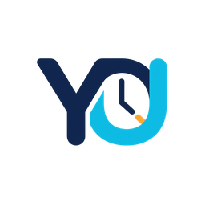</a>
</p>
